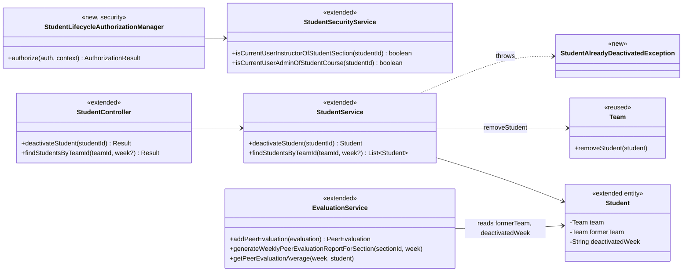
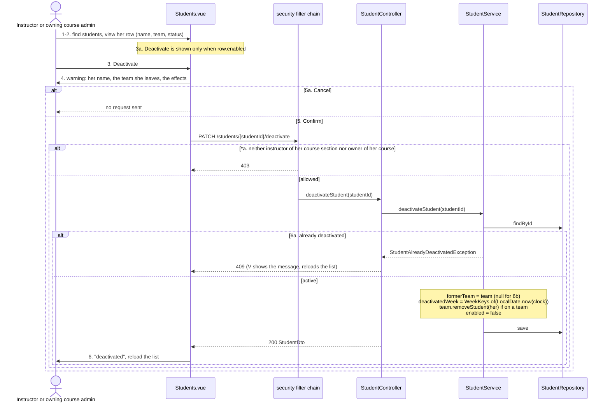
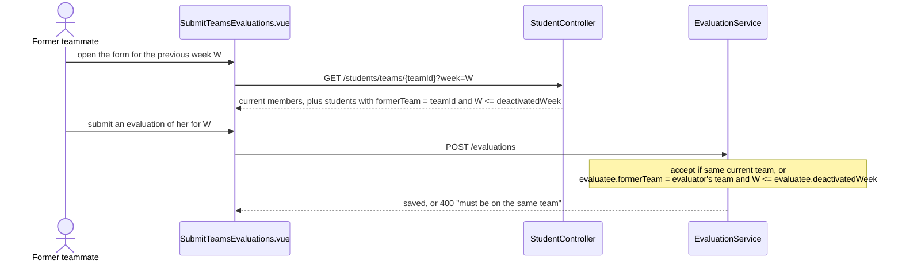
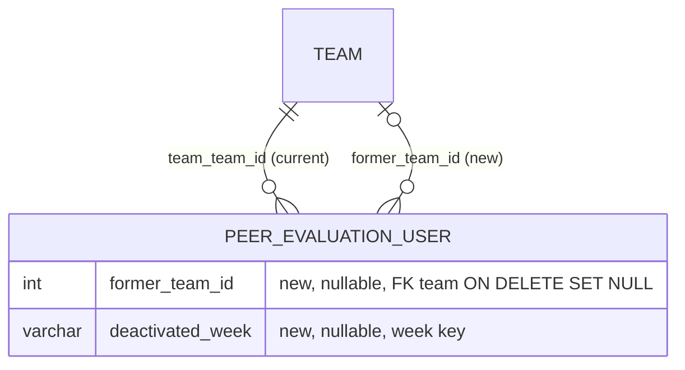

# Student (STU) Design

> Realizes: UC-STU-deactivate-student
> Depends on: FR-SEC-active-account; BR-student-lifecycle (who may deactivate, the removal from her team, the weeks she is still evaluated and reported), BR-team-admin-only, BR-section-scoped-access, BR-submission-owed, BR-evaluation-submission-window, BR-team-assignment-required
> See: [use cases](../requirements/use-cases.md#student), [business rules](../requirements/business-rules.md), [architectural-design.md](architectural-design.md#shared-foundation-components) (shared foundation component view, Crosscutting Concepts)
> Designed against `main` at `59f0267` (2026-11-05).

## Overview

This area covers the student account inside the shared foundation's `student` package. Its first designed use case is deactivation: a dedicated action that, after a warning and a confirmation, disables the account, removes the student from her team, and records which team she left and in which week. The `evaluation` slice reads that record, so that her former teammates may still evaluate her, and her course section's peer evaluation report still shows her, for the week of her deactivation and earlier weeks (BR-student-lifecycle).

Before this design, deactivation was only the `enabled` flag inside the generic `PUT /students/{studentId}` (`StudentService.updateStudent`). It had no warning and no confirmation, and it left her on her team. That path still exists and is out of scope ([OI-65](../requirements/OPEN-ISSUES.md)).

## Components & classes

| Component | File | |
|---|---|---|
| Route rule | [`SecurityConfiguration`](../../backend/src/main/java/team/projectpulse/security/SecurityConfiguration.java): `PATCH /students/{studentId}/deactivate` | new rule |
| Authorization manager | `security/authorizationmanagers/StudentLifecycleAuthorizationManager.java`: instructor of her course section **or** owner of her course; reads `studentId` with `PathVariables.readId` | new |
| Security service | [`StudentSecurityService`](../../backend/src/main/java/team/projectpulse/student/StudentSecurityService.java): reuses `isCurrentUserInstructorOfStudentSection`, adds `isCurrentUserAdminOfStudentCourse` (student → course section → course → course admin; fails closed) | extended |
| Controller, service | [`StudentController`](../../backend/src/main/java/team/projectpulse/student/StudentController.java), [`StudentService`](../../backend/src/main/java/team/projectpulse/student/StudentService.java) (injects `Clock`) | extended |
| Entity | [`Student`](../../backend/src/main/java/team/projectpulse/student/Student.java): `formerTeam`, `deactivatedWeek` | extended |
| Exception | `student/StudentAlreadyDeactivatedException.java`, mapped in [`ExceptionHandlerAdvice`](../../backend/src/main/java/team/projectpulse/system/exception/ExceptionHandlerAdvice.java) to `StatusCode.CONFLICT` | new |
| Evaluations | [`EvaluationService`](../../backend/src/main/java/team/projectpulse/evaluation/EvaluationService.java): `addPeerEvaluation`, `generateWeeklyPeerEvaluationReportForSection`, `getPeerEvaluationAverage` | extended |
| Reused | [`WeekKeys.of`](../../backend/src/main/java/team/projectpulse/system/WeekKeys.java), [`Team.removeStudent`](../../backend/src/main/java/team/projectpulse/team/Team.java) | reused |
| Frontend api | [`apis/student`](../../frontend/src/apis/student/index.ts): `deactivateStudent(id)`, `findStudentsByTeamId(teamId, week?)` | extended |
| Frontend views | [`Students.vue`](../../frontend/src/pages/students/Students.vue): Deactivate button in the Operations column, `ElMessageBox.confirm` warning; [`SubmitTeamsEvaluations.vue`](../../frontend/src/pages/evaluations/SubmitTeamsEvaluations.vue): passes the previous week when listing teammates | extended |

## Sequence

### UC-STU-deactivate-student: main success scenario

### Former teammates evaluating her (BR-student-lifecycle, week clause)

The section report for week W lists a student who is on a team, or whose `formerTeam` is set and `W <= deactivatedWeek`. `getPeerEvaluationAverage` takes the team name from `team`, falling back to `formerTeam`. Editing an existing evaluation of her (`updatePeerEvaluation`) has no team check and is unchanged.

## API contract

| Endpoint | Caller (who may) | Request | Success | Errors, by extension |
|---|---|---|---|---|
| `PATCH /students/{studentId}/deactivate` (new) | an instructor assigned to her course section, or the course admin who owns her course (BR-student-lifecycle) | no body | `200`, the `StudentDto` with `enabled: false` and no team | `*a`: `403` (the student herself, any other instructor or course admin, an id that names no student); `6a`: `409`, "already deactivated" |
| `GET /students/teams/{teamId}` (changed) | unchanged (`TeamMembershipAuthorizationManager`) | optional `week`, a week key validated by `WeekKeys.requireValid` | without `week`: current members, as before; with `week`: also her former members whose `deactivatedWeek` is that week or later | `400` for a malformed `week` |
| `POST /evaluations` (behavior changed) | unchanged | unchanged | also accepts a former teammate's evaluation of her for a week up to and including `deactivatedWeek` | `400` "must be on the same team" for a later week |
| `GET /evaluations/sections/{sectionId}/week/{week}` (behavior changed) | unchanged | unchanged | includes her, under her former team, for `week <= deactivatedWeek` | unchanged |

## Key decisions

- **The deactivation record lives on `Student` (`formerTeam`, `deactivatedWeek`).** Rejected: a team-membership history table. It is more general and would also settle a second deactivation, but it is a larger schema change than this use case needs. Also rejected: deriving her team and weeks from the evaluations already written of her, which cannot authorize a week-8 evaluation nobody has submitted yet.
- **The week is a week key (`YYYY-Www`) compared as a string.** It matches `PeerEvaluation.week` and `WeekKeys`, and the format sorts lexically. It is computed from the injected `Clock`. Rejected: storing a timestamp, which would need converting to a week on every comparison.
- **A dedicated `PATCH /students/{studentId}/deactivate`.** Rejected: reusing the `enabled` flag of `PUT /students/{studentId}`, which has no place for the team removal or the recorded week, and which the student herself may call. That leftover path is OI-65.
- **A new `StudentLifecycleAuthorizationManager`.** It allows the instructor of her course section or the owner of her course (BR-student-lifecycle, BR-section-scoped-access). Rejected: `UserOwnershipAuthorizationManager`, which admits the student herself and refuses an owning course admin who is not assigned to the course section. UC-STU-reactivate-student is expected to reuse this manager.
- **Extension 6a is refused with `409`.** Rejected: an idempotent `200`, which would hide a second deactivation and invite overwriting the recorded week.
- **`formerTeam` uses `ON DELETE SET NULL`.** Rejected: restrict, which would stop a course admin from ever deleting a team that once had a deactivated member. Consequence: once that team is deleted, she drops out of its old reports, as its other members do.
- **The action lives in the Students list's Operations column.** That row already shows the details step 2 needs (name, team, status). Rejected: the per-student dashboard, because `GET /students/{studentId}` refuses an owning course admin who is not assigned to the course section. Widening that route belongs to UC-STU-view-student.
- **No change to the JWT or the session.** FR-SEC-active-account accepts access until the session token issued before deactivation expires. Rejected: checking `enabled` on every request, a change to the shared security chain that the developer decided against.
- **Reminders need no change.** `SubmissionStatusService.findOwedItems` already counts only current, active team members, so nobody owes an evaluation of her and she owes nothing (BR-submission-owed). This is covered by a test, not by code.

## Data model

`Student` maps to `peer_evaluation_user` (single-table inheritance from `PeerEvaluationUser`). The delta is two nullable columns, added for staging and prod by a new Flyway migration (`V7__student_deactivation.sql`); `dev` picks them up from the entity. The shared graph is in the SRS's Business Domain Model.

## Reuse & cross-cutting

- **Authorization:** both enforcement points from [Authorization](architectural-design.md#authorization). The new route rule is the first point. The service then loads the student by the path id, the only id in the request.
- **Time:** the deactivation week comes from the profile's `Clock` bean ([Architectural conventions](architectural-design.md#architectural-conventions)), so tests run on the dev clock, week `2023-W33`.
- **Errors:** the `Result` envelope via `ExceptionHandlerAdvice`. Email is not used (no notification on deactivation).

## Tests

| Use case, flow | Level | Asserts |
|---|---|---|
| UC-STU-deactivate-student main, assigned instructor | integration | `200`; she is `enabled: false`, on no team, `formerTeam` is her old team, `deactivatedWeek` is `2023-W33`; her old team no longer lists her as a current member; her activities and evaluations are unchanged |
| UC-STU-deactivate-student main, owning course admin | integration | The course admin who owns her course but is not assigned to her course section gets `200` |
| UC-STU-deactivate-student *a, instructor | integration | An instructor not assigned to her course section gets `403`; she is unchanged |
| UC-STU-deactivate-student *a, students and ids | integration | The student herself and a student of another team get `403`; an id that names no student gets `403` |
| UC-STU-deactivate-student 6a | integration | Deactivating her again gets `409`; `formerTeam` and `deactivatedWeek` keep their first values |
| UC-STU-deactivate-student 6b | integration | A student on no team: `200`, `deactivatedWeek` set, `formerTeam` empty |
| UC-STU-deactivate-student access (FR-SEC-active-account) | integration | A new login as her is refused (`401`); a token issued to her before deactivation still authorizes a request (the accepted window) |
| Evaluations of her, up to her deactivation week | unit | A former teammate's evaluation of her is accepted for the deactivation week and for an earlier week |
| Evaluations of her, after her deactivation week | unit | Refused with "must be on the same team" |
| Editing an evaluation of her | unit | An edit of an evaluation of her within its window is accepted after her deactivation |
| Section peer evaluation report | integration | She appears under her former team's name for a week up to her deactivation week, and is absent for a later week |
| Evaluation form list | integration | `GET /students/teams/{teamId}?week=W` includes her for `W <= deactivatedWeek` and not after; without `week` only current members; a malformed `week` gets `400` |
| BR-submission-owed after deactivation | integration | She owes nothing; a former teammate who evaluated every current member but not her owes nothing |
| Service logic | unit | `deactivateStudent` sets the record and removes her from her team; an already deactivated student throws `StudentAlreadyDeactivatedException` |
| UC-STU-deactivate-student 3a, 4, 5a, 6, 6a UI | E2E (Cypress, API stubbed) | Deactivate is hidden for a deactivated row; the warning names her and her team; Cancel sends no request; Confirm sends one `PATCH` and reloads; a `409` shows its message and reloads the list |

## Open questions / risks

- **A second deactivation** after a reactivation overwrites `formerTeam` and `deactivatedWeek`, so she would drop out of her first team's old reports. This is recorded in UC-STU-reactivate-student's Open Issues. A membership-history table is the fix if it matters.
- **The OI-65 path:** a student disabled through the generic edit has no `deactivatedWeek` and stays on her team, so this design treats her as active for evaluations and reports.
- **Tests that need a later week** set `deactivatedWeek` directly, since the dev clock is fixed.
