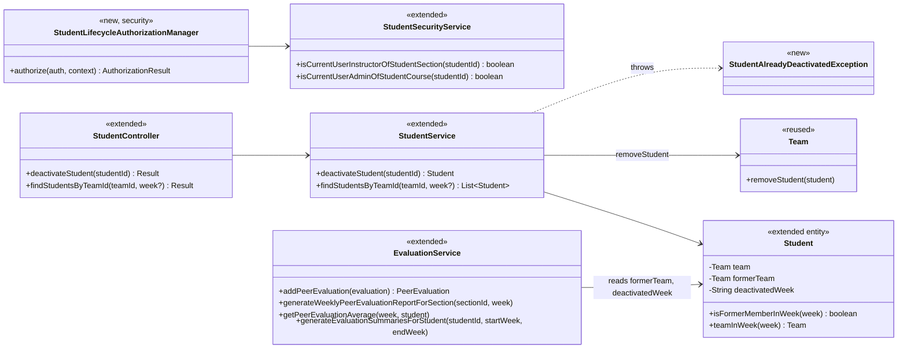
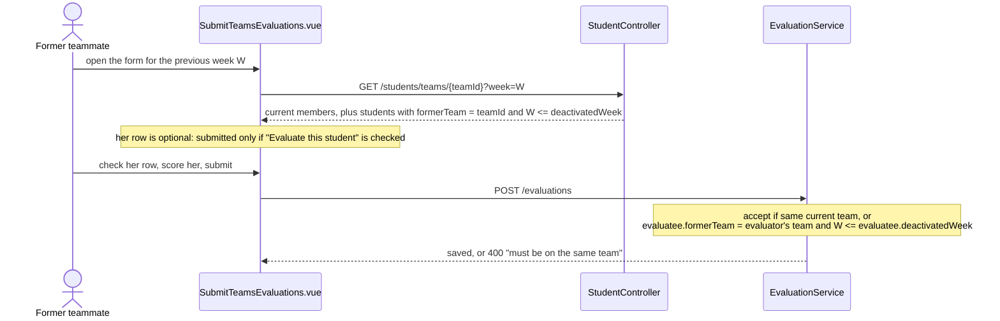
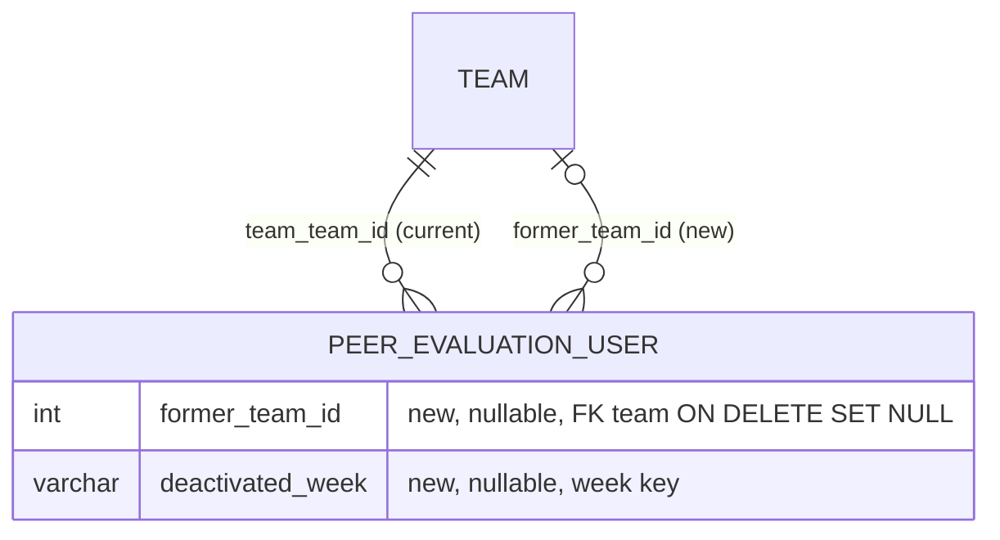

# Student (STU) Design

> Realizes: UC-STU-deactivate-student
> Depends on: FR-SEC-active-account; BR-student-lifecycle (who may deactivate, the removal from her team, the weeks she is still evaluated and reported), BR-team-admin-only, BR-section-scoped-access, BR-submission-owed, BR-evaluation-submission-window, BR-team-assignment-required
> See: [use cases](../requirements/use-cases.md#student), [business rules](../requirements/business-rules.md), [architectural-design.md](architectural-design.md#shared-foundation-components) (shared foundation component view, Crosscutting Concepts)
> Designed against `main` at `59f0267` (2026-11-05).

## Overview

This area covers the student account inside the shared foundation's `student` package. Its first designed use case is deactivation: a dedicated action that, after a warning and a confirmation, disables the account, removes the student from her team, and records which team she left and in which week. The `evaluation` slice reads that record, so that her former teammates may still evaluate her, and her course section's peer evaluation report still shows her, for the week of her deactivation and earlier weeks (BR-student-lifecycle).

Before this design, deactivation was only the `enabled` flag inside the generic `PUT /students/{studentId}` (`StudentService.updateStudent`). It had no warning and no confirmation, and it left her on her team. That path still exists and is out of scope ([OI-65](../requirements/OPEN-ISSUES.md)).

## Components & classes



| Component | File | |
|---|---|---|
| Route rule | [`SecurityConfiguration`](../../backend/src/main/java/team/projectpulse/security/SecurityConfiguration.java): `PATCH /students/{studentId}/deactivate` | new rule |
| Authorization manager | `security/authorizationmanagers/StudentLifecycleAuthorizationManager.java`: instructor of her course section **or** owner of her course; reads `studentId` with `PathVariables.readId` | new |
| Security service | [`StudentSecurityService`](../../backend/src/main/java/team/projectpulse/student/StudentSecurityService.java): reuses `isCurrentUserInstructorOfStudentSection`, adds `isCurrentUserAdminOfStudentCourse` (student → course section → course → course admin; fails closed) | extended |
| Controller, service | [`StudentController`](../../backend/src/main/java/team/projectpulse/student/StudentController.java), [`StudentService`](../../backend/src/main/java/team/projectpulse/student/StudentService.java) (injects `Clock`) | extended |
| Entity | [`Student`](../../backend/src/main/java/team/projectpulse/student/Student.java): `formerTeam`, `deactivatedWeek`; `isFormerMemberInWeek(week)` and `teamInWeek(week)` state the "week of her deactivation or earlier" rule once, for `StudentService` and `EvaluationService` to share | extended |
| Exception | `student/StudentAlreadyDeactivatedException.java`, mapped in [`ExceptionHandlerAdvice`](../../backend/src/main/java/team/projectpulse/system/exception/ExceptionHandlerAdvice.java) to `StatusCode.CONFLICT` | new |
| Repository | [`StudentRepository`](../../backend/src/main/java/team/projectpulse/student/StudentRepository.java): a finder that loads the student by id **scoped to the caller** (an instructor of her course section, or the course admin of her course) with a pessimistic write lock | extended |
| Evaluations | [`EvaluationService`](../../backend/src/main/java/team/projectpulse/evaluation/EvaluationService.java): `addPeerEvaluation`, `generateWeeklyPeerEvaluationReportForSection`, `getPeerEvaluationAverage`, `generateEvaluationSummariesForStudent` | extended |
| Reused | [`WeekKeys.of`](../../backend/src/main/java/team/projectpulse/system/WeekKeys.java), [`Team.removeStudent`](../../backend/src/main/java/team/projectpulse/team/Team.java) | reused |
| Frontend api | [`apis/student`](../../frontend/src/apis/student/index.ts): `deactivateStudent(id)`, `findStudentsByTeamId(teamId, week?)` | extended |
| Frontend views | [`Students.vue`](../../frontend/src/pages/students/Students.vue): Deactivate button in the Operations column, `ElMessageBox.confirm` warning; [`SubmitTeamsEvaluations.vue`](../../frontend/src/pages/evaluations/SubmitTeamsEvaluations.vue): passes the week it already evaluates (`previousWeek`) when listing teammates, and shows a listed student who is not a current member of the team (her `teamId` is not the form's team) as an **optional** row: marked "deactivated, optional", with an "Evaluate this student" checkbox that is off by default, and her row is submitted only when it is checked | extended |

## Sequence

### UC-STU-deactivate-student: main success scenario

```mermaid
sequenceDiagram
    actor I as Instructor or owning course admin
    participant V as Students.vue
    participant SEC as security filter chain
    participant C as StudentController
    participant S as StudentService
    participant R as StudentRepository
    I->>V: 1-2. find students, view her row (name, team, status)
    Note over V: 3a. Deactivate is shown only when row.enabled
    I->>V: 3. Deactivate
    V->>I: 4. warning: her name, the team she leaves (or "not on a team", 6b), the effects
    alt 5a. Cancel, or the dialog closed (X, Esc)
        V-->>I: no request sent
    else 5. Confirm
        V->>SEC: PATCH /students/{studentId}/deactivate
        alt *a. neither instructor of her course section nor owner of her course
            SEC-->>V: 403
        else allowed
            SEC->>C: deactivateStudent(studentId)
            C->>S: deactivateStudent(studentId)
            S->>R: find by id, scoped to the caller, locked for write
            alt 6a. already deactivated (enabled is false)
                S-->>C: StudentAlreadyDeactivatedException
                C-->>V: 409 (the shared interceptor shows the message; V reloads the list)
            else active
                Note over S: formerTeam = team (null for 6b)<br/>deactivatedWeek = WeekKeys.of(LocalDate.now(clock))<br/>team.removeStudent(her) if on a team<br/>enabled = false
                S->>R: save
                C-->>V: 200 StudentDto
                V->>I: 6. "deactivated", reload the list
            end
        end
    end
```

### Former teammates evaluating her (BR-student-lifecycle, week clause)



The section report for week W lists a student who is on a team, or whose `formerTeam` is set and `W <= deactivatedWeek`. `getPeerEvaluationAverage` names her team as `formerTeam` for any week up to `deactivatedWeek`, and as `team` otherwise, so a student later reactivated and reassigned still shows under her first team for those weeks. Her own per-student report (`generateEvaluationSummariesForStudent`, UC-EVA-student-evaluation-report) stops at `deactivatedWeek`: it returns no row for a later week, since she appears in no peer evaluation report for those weeks. Editing an existing evaluation of her (`updatePeerEvaluation`) has no team check and is unchanged.

## API contract

| Endpoint | Caller (who may) | Request | Success | Errors, by extension |
|---|---|---|---|---|
| `PATCH /students/{studentId}/deactivate` (new) | an instructor assigned to her course section, or the course admin who owns her course (BR-student-lifecycle) | no body | `200`, the `StudentDto` with `enabled: false` and no team (`formerTeam` and `deactivatedWeek` are not exposed) | `*a`: `403` (the student herself, any other instructor or course admin, an id that names no student); `6a`: HTTP `409` with the `Result` envelope, code `CONFLICT`, "already deactivated" |
| `GET /students/teams/{teamId}` (changed) | unchanged (`TeamMembershipAuthorizationManager`) | optional `week`, a week key validated by `WeekKeys.requireValid` | without `week`: current members, as before; with `week`: also her former members whose `deactivatedWeek` is that week or later | `400` for a malformed `week` |
| `POST /evaluations` (behavior changed) | unchanged | unchanged | also accepts a former teammate's evaluation of her for a week up to and including `deactivatedWeek` | `400` "must be on the same team" for a later week |
| `GET /evaluations/sections/{sectionId}/week/{week}` (behavior changed) | unchanged | unchanged | includes her, under her former team, for `week <= deactivatedWeek` | unchanged |
| `GET /evaluations/students/{studentId}` (behavior changed) | unchanged | unchanged | for a deactivated student, no rows for weeks after `deactivatedWeek` | unchanged |

## Key decisions

- **The deactivation record lives on `Student` (`formerTeam`, `deactivatedWeek`).** Rejected: a team-membership history table. It is more general and would also settle a second deactivation, but it is a larger schema change than this use case needs. Also rejected: deriving her team and weeks from the evaluations already written of her, which cannot authorize a week-8 evaluation nobody has submitted yet.
- **The week is a week key (`YYYY-Www`) compared as a string.** It matches `PeerEvaluation.week` and `WeekKeys`, and the format sorts lexically. It is computed from the injected `Clock`. Rejected: storing a timestamp, which would need converting to a week on every comparison.
- **A dedicated `PATCH /students/{studentId}/deactivate`.** Rejected: reusing the `enabled` flag of `PUT /students/{studentId}`, which has no place for the team removal or the recorded week, and which the student herself may call. That leftover path is OI-65.
- **A new `StudentLifecycleAuthorizationManager`.** It allows the instructor of her course section or the owner of her course (BR-student-lifecycle, BR-section-scoped-access). Rejected: `UserOwnershipAuthorizationManager`, which admits the student herself and refuses an owning course admin who is not assigned to the course section. UC-STU-reactivate-student is expected to reuse this manager.
- **Extension 6a is refused with `409`, and it tests `enabled == false`.** Rejected: an idempotent `200`, which would hide a second deactivation and invite overwriting the recorded week. Testing `enabled` (not `deactivatedWeek != null`) matches 3a, where the action is hidden for any disabled account, so a student disabled through the OI-65 path is refused too.
- **The student is loaded locked for write.** Two confirms at once would otherwise both read her as active, and the second would record her former team as none, erasing the first one's record. With the lock, the second waits, then sees `enabled == false` and gets `409`. Rejected: accepting the race, and `@Version` optimistic locking, which `Student` does not carry and which would turn the race into an unhandled optimistic-lock error instead of the 6a refusal.
- **The load is scoped to the caller, not a bare `findById`.** This is the second enforcement point of [Authorization](architectural-design.md#authorization): on a flat route the scope comes from the caller, so the finder only returns a student whose course section the caller instructs or whose course she owns. Rejected: relying on the route rule alone.
- **Her row in the evaluation form is optional.** The form submits every listed row with one Submit, so listing her as an ordinary row would make evaluating her required in practice, against "they do not owe them" (BR-student-lifecycle, BR-submission-owed). Rejected: an ordinary row (effectively required), and not listing her (no way to evaluate her for a week she was a member). The row is marked optional because she is not a current member of the team, not because `enabled` is false. The two are the same today, but a student later reactivated onto another team is active and still not this team's member (changed at implementation).
- **`formerTeam` uses `ON DELETE SET NULL`,** declared on the entity with `@OnDelete(action = OnDeleteAction.SET_NULL)` so that `dev` and the integration tests (`ddl-auto: create`) get the same foreign key the Flyway migration creates. Rejected: restrict, which would stop a course admin from ever deleting a team that once had a deactivated member. Consequence: once that team is deleted, she drops out of its old reports, as its other members do.
- **The action lives in the Students list's Operations column.** That row already shows the details step 2 needs (name, team, status). Rejected: the per-student dashboard, because `GET /students/{studentId}` refuses an owning course admin who is not assigned to the course section. Widening that route belongs to UC-STU-view-student.
- **No change to the JWT or the session.** FR-SEC-active-account accepts access until the session token issued before deactivation expires. Rejected: checking `enabled` on every request, a change to the shared security chain that the developer decided against.
- **Reminders need no change.** `SubmissionStatusService.findOwedItems` already counts only current, active team members, so nobody owes an evaluation of her and she owes nothing (BR-submission-owed). This is covered by a test, not by code.

## Data model



`Student` maps to `peer_evaluation_user` (single-table inheritance from `PeerEvaluationUser`). The delta is two nullable columns, added for staging and prod by a new Flyway migration (`V7__student_deactivation.sql`); `dev` picks them up from the entity. The shared graph is in the SRS's Business Domain Model.

## Reuse & cross-cutting

- **Authorization:** both enforcement points from [Authorization](architectural-design.md#authorization): the new route rule, then the caller-scoped finder. The reused `isCurrentUserInstructorOfStudentSection` compares the caller with her course section's instructors, so a student never passes and an instructor's default course section does not matter. A `403` routes the browser to the forbidden page (the shared interceptor).
- **The old edit path:** `updateStudent` applies `enabled` only for a caller with `ROLE_instructor`, so a deactivated student holding her old token cannot reactivate herself through `PUT /students/{studentId}`.
- **Login:** a disabled account already fails login with HTTP `401` (`MyUserPrincipal.isEnabled` → `AccountStatusException` in `ExceptionHandlerAdvice`); nothing changes there.
- **Time:** the deactivation week comes from the profile's `Clock` bean ([Architectural conventions](architectural-design.md#architectural-conventions)), so tests run on the dev clock, week `2023-W33`. `WeekKeys.of` uses ISO weeks and the ISO week-based year, so string comparison of week keys is safe. The evaluation form keeps the week it already computes for submission; this design adds no second week calculation.
- **Errors:** the `Result` envelope via `ExceptionHandlerAdvice`. Email is not used (no notification on deactivation).

## Tests

| Use case, flow | Level | Asserts |
|---|---|---|
| UC-STU-deactivate-student main, assigned instructor | integration | `200`; she is `enabled: false`, on no team, `formerTeam` is her old team, `deactivatedWeek` is `2023-W33`; her old team no longer lists her as a current member; her activities and evaluations are unchanged |
| UC-STU-deactivate-student main, owning course admin | integration | The course admin who owns her course but is not assigned to her course section gets `200` |
| UC-STU-deactivate-student *a, instructor | integration | An instructor not assigned to her course section gets `403`; she is unchanged |
| UC-STU-deactivate-student *a, students and ids | integration | The student herself and a student of another team get `403`; an id that names no student gets `403` |
| UC-STU-deactivate-student 6a | integration | Deactivating her again gets `409`; `formerTeam` and `deactivatedWeek` keep their first values |
| UC-STU-deactivate-student 6b | integration | A student on no team: `200`, `deactivatedWeek` set, `formerTeam` empty |
| UC-STU-deactivate-student access (FR-SEC-active-account) | integration | A new login as her is refused (`401`); a token issued to her before deactivation still authorizes `GET /students/{herId}` (the accepted window) |
| Evaluations of her, up to her deactivation week | unit | A former teammate's evaluation of her is accepted for the deactivation week and for an earlier week |
| Evaluations of her, after her deactivation week | unit | Refused with "must be on the same team" (the test sets `deactivatedWeek` before the open week, so the submission window check passes and the team check refuses) |
| Editing an evaluation of her | unit | An edit of an evaluation of her within its window is accepted after her deactivation |
| Section peer evaluation report | integration | She appears under her former team's name for a week up to her deactivation week, and is absent for a later week |
| Report team name after reassignment | unit | A student with `formerTeam` A and `deactivatedWeek` D who is now on team B is named under A for a week up to D and under B for a later week |
| Her own per-student report | integration | `GET /evaluations/students/{studentId}` over a range that spans her deactivation week returns rows up to `deactivatedWeek` and none after |
| UC-STU-deactivate-student 6a, concurrent | integration | Two deactivation requests for her at once: one gets `200`, the other `409`, and `formerTeam` is her old team |
| Caller-scoped finder | integration (repository) | The finder returns her for an instructor of her course section and for the course admin of her course, and nothing for an instructor of another course section |
| Evaluation form, optional row | E2E (Cypress, API stubbed) | A listed deactivated former member is marked "deactivated, optional"; with her checkbox off, Submit sends no evaluation of her; checked and scored, Submit sends one |
| Evaluation form list | integration | `GET /students/teams/{teamId}?week=W` includes her for `W <= deactivatedWeek` and not after; without `week` only current members; a malformed `week` gets `400` |
| BR-submission-owed after deactivation | integration | She owes nothing; a former teammate who evaluated every current member but not her owes nothing |
| Service logic | unit | `deactivateStudent` sets the record and removes her from her team; an already deactivated student throws `StudentAlreadyDeactivatedException` |
| UC-STU-deactivate-student 3a, 4, 5a, 6, 6a UI | E2E (Cypress, API stubbed) | Deactivate is hidden for a deactivated row; the warning names her and her team, or says "not on a team"; Cancel and closing the dialog send no request; Confirm sends one `PATCH` and reloads; a `409` shows its message and reloads the list |

## Open questions / risks

- **A second deactivation** after a reactivation overwrites `formerTeam` and `deactivatedWeek`, so she would drop out of her first team's old reports. This is recorded in UC-STU-reactivate-student's Open Issues. A membership-history table is the fix if it matters.
- **The OI-65 path:** a student disabled through the generic edit has no `deactivatedWeek` and stays on her team, so this design treats her as active for evaluations and reports.
- **Tests that need a later week** set `deactivatedWeek` directly, since the dev clock is fixed. Tests read `formerTeam` and `deactivatedWeek` from the repository; they are not in `StudentDto`.
- **The single-week lookup** `GET /evaluations/students/{studentId}/week/{week}` is unchanged: for a week after her deactivation it reports no evaluations of her, since none can be submitted. It is a lookup by the instructor, not a listing.
- **The owning course admin and the Students list:** the list is scoped to her default course section (`UserUtils.getUserSectionId`), so she reaches the row once that course section is her default, as for every action on that list.
- **Edits during the token window:** until her session token expires she can still edit records she authored whose edit paths have no team check (her open peer evaluations). This is inside the window FR-SEC-active-account accepts.
